# T20 Role Patrol — Hackathon Implementation & Deployment Guide


> **Project Name:** `T20_Role_Patrol`  

> **Target Audience:** Hackathon Team 20 (4–5 Members)  

> **Environment:** Blank-Slate Dedicated Azure Lab Subscription (`centralus` or designated lab region)  

> **Working Directory:** `C:\Users\arvin\OneDrive\Documents\MyProjects\Hackathon_2026\t020_36de74` (all relative paths `.\datasets\`, `.\scripts\`, `.\sql\`, `.\templates\` resolve here)  

> **Zero Resource Reuse Rule:** All Azure resources are provisioned completely fresh. No reuse of existing resource groups, servers, databases, or logic apps.  

> **Resource Naming Standard:** All resources carry the **`t020_`** prefix (or the DNS-compliant lowercase equivalent **`t020-`** where Azure forbids uppercase letters and underscores).  

> **Zero Hardcoding / Cheating Rule:** 100% genuine data flow. All metrics, role rankings, What-If simulations, and evidence records are calculated dynamically by the Azure SQL engine from the 8 dataset CSVs in `.\datasets\`. Zero hardcoded counts, zero pre-canned metrics.  

> **Lab Resources & Quotas:** Standard enterprise lab capacity (No SKU quota restrictions; full support for Azure AI Search Basic, Azure SQL Serverless Gen5, Logic Apps, and Data Factory).  

> **Dataset:** 8 Production-grade synthetic CSV files located in `.\datasets\` (500 employees, 75 business roles, 40 applications, 250 entitlements, 900 role-entitlements, 650 assignments, 175 JML events, 600 access request tickets).  

> **Estimated Total Execution Time:** 45–60 minutes (with parallel track execution).  


---


## 1. Master Azure Components & Services Blueprint


To build `T20_Role_Patrol` from scratch on a blank-slate Azure lab, the following components and services must be provisioned. Every resource follows the strict `t020_` prefix standard (or `t020-` where DNS constraints require lowercase kebab-case):


| Component / Service Name | Azure Service Type | Creation Tool / Mechanism | Assigned Track & Owner | Purpose in `T20_Role_Patrol` | Sizing, Tier & Key Configuration |
|---|---|---|---|---|---|
| **`rg-t020-<suffix>`** | Resource Group | Azure CLI (`az group create`) | **Phase 0:** Team Lead | Isolated container for all project assets. Guarantees zero resource reuse. | Region: `centralus`, Tags: `Project=T20_Role_Patrol`, `Team=t020`. |
| **`t020-sql-<suffix>`** | Azure SQL Server | Azure CLI (`az sql server create`) | **Track B:** Member 2 | Host for core relational ledger, engine procedures, and security principal maps. | Microsoft Entra-Only Authentication enabled; Azure Services firewall rule open. |
| **`t020_rolepatrol`** | Azure SQL Database | Azure CLI (`az sql db create`) | **Track B:** Member 2 | Stores 8 dataset CSV tables (`src.*`), governance engine (`core.*`), casework audit (`casework.*`), and search views (`search.*`). | GeneralPurpose Gen5, 2 vCores, Serverless, Auto-pause: 240 mins (prevents demo cold starts). |
| **`t020-adf-<suffix>`** | Azure Data Factory | Azure CLI (`az datafactory create`) | **Track C:** Member 3 | Autonomous orchestrator for data ingestion and role friction assessment. | V2 Data Factory with System-Assigned Managed Identity (MSI). |
| **`RolePatrolAssessment`** | ADF Pipeline | Azure CLI / REST API (`az datafactory pipeline create`) | **Track C:** Member 3 | Executes `core.usp_Ingest` and `core.usp_Assess` stored procedures over the 600 tickets. | Anchored to `@BusinessAsOf = '2026-10-01T12:00:00'` to cleanly envelop the dataset. |
| **`t020-srch-<suffix>`** | Azure AI Search | Azure CLI (`az search service create`) | **Track D:** Member 4 | Natural-language semantic search engine for the 600 access request tickets. | **Basic SKU** (avoids Free SKU quota conflicts and supports semantic reranker). |
| **`ticket-text`** | AI Search Index | REST API (`Invoke-RestMethod`) | **Track D:** Member 4 | Reverse-index mapping ticket complaint text, ticket IDs, types, and context codes. | Fields: `ticketId`, `ticketText`, `ticketType`, `contextCode`. |
| **`t020-swa-<suffix>`** | Azure Static Web Apps | Azure CLI (`az staticwebapp create`) | **Track D:** Member 4 | Global CDN hosting the responsive Single Page Application (SPA) governance portal. Hostname saved dynamically to `names.json`. | Free SKU, deployed via SWA CLI (`npx.cmd @azure/static-web-apps-cli deploy ./dist`). |
| **`t020_la_collect_<suffix>`** | Azure Logic App | Azure CLI (`az logic workflow create`) | **Track C:** Member 3 | Collector workflow syncing live Entra ID security group memberships into SQL `stg.GroupMembership`. | Consumption tier, System-Assigned MSI with Graph `GroupMember.Read.All` role. |
| **`t020_la_api_a_<suffix>`** | Azure Logic App | Azure CLI (`az logic workflow create`) | **Track C:** Member 3 | Secured API Gateway for **US Lead (Doreni Arvenor, `GID0004`)**. Invokes `api.usp_Gateway`. | Consumption tier, MSI mapped to SQL user with binary SID, OAuth 2.0 trigger claim validation. |
| **`t020_la_api_b_<suffix>`** | Azure Logic App | Azure CLI (`az logic workflow create`) | **Track C:** Member 3 | Secured API Gateway for **Canada Lead (Alira Arvenor, `GID0001`)**. Invokes `api.usp_Gateway`. | Consumption tier, MSI mapped to SQL user with binary SID, OAuth 2.0 trigger claim validation. |
| **`t020_la_shell_<suffix>`** | Azure Logic App | Azure CLI (`az logic workflow create`) | **Track C:** Member 3 | Administrative shell and maintenance proxy workflow. | Consumption tier, System-Assigned MSI. |
| **`t020_RolePatrol-API-<suffix>`** | Entra App Registration | Azure CLI (`az ad app create`) | **Track A:** Member 1 | OAuth 2.0 Resource Server exposing the backend governance API. | Exposes delegated scope `RolePatrol.Access`, requests token v2. |
| **`t020_RolePatrol-Browser-<suffix>`** | Entra App Registration | Azure CLI (`az ad app create`) | **Track A:** Member 1 | OAuth 2.0 Client application representing the browser Single Page App. | Configured as SPA redirect URI (`https://<swa-url>/bridge.html`), authorized for `RolePatrol.Access`. |
| **Entra Users & Security Groups** | Entra ID Directory | PowerShell Script (`Import-DirectoryFromDataset.ps1`) | **Track A:** Member 1 | Live identity directory reflecting GM Financial cohort employees and entitlement groups. | 30 active employees (including leads `GID0004` & `GID0001`), 16 entitlement security groups (`ENT0001`–`ENT0016`). Full 500-employee cohort in SQL. |


---


## 2. Parallel Team Delegation & Synchronization Gates


`T20_Role_Patrol` is structured into **four parallel tracks** following a shared bootstrap phase. Each track is assigned to a specific team member, bounded by **4 Synchronization Gates** to eliminate race conditions and configuration mismatches.

```mermaid
flowchart TD
    subgraph P0["Phase 0: Environment Setup — 5 min"]
        RG["Resource Group (rg-t020-suffix)"]
        RP["Register Resource Providers"]
        REG["Generate Shared Registry (names.json)"]
    end

    subgraph TrackA["Track A: Identity & Security — 10 min"]
        A1["A1: Ingest/Verify Synthetic Entra Directory"]
        A2["A2: Register API App & Expose RolePatrol.Access Scope"]
        A3["A3: Register SPA App & Grant Admin Consent"]
    end

    subgraph TrackB["Track B: Data & Engine — 15 min"]
        B1["B1: Azure SQL Server (t020-sql) & DB (Serverless Gen5)"]
        B2["B2: SQL Firewall Rules (LaptopAdmin + AzureInternal)"]
        B3["B3: Deploy Schemas (01-07) & Ingest 8 CSV Datasets"]
    end

    subgraph TrackC["Track C: Orchestration & Compute — 15 min"]
        C1["C1: Azure Data Factory & Assessment Pipeline (2026-10-01)"]
        C2["C2: 4 Logic Apps with System-Assigned Managed Identities"]
        C3["C3: Grant Graph Directory Read Permissions to Collector"]
        C4["C4: Provision SQL Managed Identity Users & Permissions"]
    end

    subgraph TrackD["Track D: Search & Web Portal — 15 min"]
        D1["D1: Azure AI Search (Basic SKU) & Enriched Ticket Index"]
        D2["D2: Azure Static Web App Resource & SwaUrl Resolution"]
        D3["D3: Register SWA Redirect URI in Entra ID"]
        D4["D4: Deploy Logic App Gateways (Deploy-LogicAppGateway.ps1)"]
        D5["D5: Build Zero-Dependency Web Artifacts (npm run build)"]
        D6["D6: Deploy Production Web Portal to Azure SWA"]
    end

    subgraph P5["Phase 5: Verification & Live Demo — 10 min"]
        V1["Trigger Live Entra Collection & ADF Assessment Pipeline"]
        V2["Execute Automated Validation Suite (23 Core Contracts)"]
        V3["Present 4-Step GM Financial Pitch & Live Portal Demo"]
    end

    P0 --> TrackA
    TrackA --> TrackB
    TrackB --> TrackC
    TrackC --> TrackD
    TrackD --> P5
```





---


### Team Roles & Ownership Matrix


| Track | Owner / Role | Deliverables & Responsibilities | Upstream Dependencies | Downstream Consumers |
|---|---|---|---|---|
| **Phase 0** | **Team Lead** | Resource Group `rg-t020-<suffix>`, Provider registrations, generate `names.json`, distribute config to team. | Azure Subscription access. | All Members. |
| **Track A** | **Member 1 (Identity & Security)** | Provision Entra users & groups from `EMPLOYEE_IDENTITY.csv` & `ENTITLEMENT_CATALOG.csv`, `identity-map.sql`, API & SPA App Registrations (`t020_RolePatrol-*`), Graph API permissions. | `names.json` from Phase 0, Dataset CSVs. | Member 2 (SQL map), Member 3 & 4 (App IDs). |
| **Track B** | **Member 2 (Database & Engine)** | Azure SQL Server (`t020-sql-*`), `t020_rolepatrol` DB, Schemas 01–06, execute `Import-HackathonDatasets.ps1` for 8 CSVs, MSI SQL Logins & Least-Privilege grants. | `names.json`, `identity-map.sql` from Track A, MSI IDs from Track C. | Member 3 (ADF/Logic Apps), Member 4 (Search). |
| **Track C** | **Member 3 (Backend & Orchestration)** | Azure Data Factory (`t020-adf-*`), Assessment Pipeline (anchored to `2026-10-01`), 4 Logic Apps (`t020_la_*`), Graph role assignment, SQL API Connections, OAuth trigger URLs. | `names.json`, SQL Server from Track B, API Client ID from Track A. | Member 2 (MSI IDs for SQL), Member 4 (API URLs). |
| **Track D** | **Member 4 (Frontend & Search)** | Azure AI Search (`t020-srch-*`) indexing 600 tickets, Azure Static Web Apps (`t020-swa-*`), compile MSAL bundles, publish live web portal. | `names.json`, SWA URL for Track A, API URLs from Track C, SQL from Track B. | Phase 5 (Live Portal). |
| **Phase 5** | **Whole Team** | Run collection, trigger assessment, run validation checks, rehearse GM Financial judge presentation. | All tracks deployed. | Hackathon Judges. |


---


### Azure Resource Naming Architecture for `t020`


> [!IMPORTANT]

> **Azure Syntax Compliance:** Resource types that require DNS-compliant names (Azure SQL, Search, Data Factory, Static Web Apps) strictly prohibit uppercase letters and underscores (`_`). For these, we use the equivalent lowercase kebab-case `t020-`. All other services use `t020_`.


| Azure Resource Type | Compliant Resource Name Pattern | Reason for Naming Convention |
|---|---|---|
| **Resource Group** | `rg-t020-<suffix>` | Allows alphanumeric, hyphens, and underscores. |
| **Azure SQL Server** | `t020-sql-<suffix>.database.windows.net` | Strict Azure rule: **lowercase letters, digits, and hyphens only**. No underscores. |
| **Azure SQL Database** | `t020_rolepatrol` | Allows alphanumeric and underscores. |
| **Azure AI Search** | `t020-srch-<suffix>` | Strict Azure rule: **lowercase letters, digits, and hyphens only**. No underscores. |
| **Azure Data Factory** | `t020-adf-<suffix>` | Strict Azure rule: **letters, numbers, and hyphens only**. No underscores. |
| **Azure Static Web Apps** | `t020-swa-<suffix>` | Subdomain of `azurestaticapps.net`. **No underscores allowed**. |
| **Logic App (ApiA)** | `t020_la_api_a_<suffix>` | Allows alphanumeric and underscores. |
| **Logic App (ApiB)** | `t020_la_api_b_<suffix>` | Allows alphanumeric and underscores. |
| **Logic App (Collector)** | `t020_la_collect_<suffix>` | Allows alphanumeric and underscores. |
| **Logic App (Shell)** | `t020_la_shell_<suffix>` | Allows alphanumeric and underscores. |
| **Entra API App** | `t020_RolePatrol-API-<suffix>` | Fully supports mixed case and underscores. |
| **Entra Browser SPA** | `t020_RolePatrol-Browser-<suffix>` | Fully supports mixed case and underscores. |

---

### Cross-Track Hand-Off Exchange Sheet

Use this cheat sheet to record and exchange dynamic values between team members during the hackathon:

| Variable Name | Generated By | Consumed By | t020 Value / Description |
|---|---|---|---|
| `$SUFFIX` | Team Lead (Phase 0) | All Members | e.g., `9a2f1b` (6-char unique hex suffix) |
| `$names.ResourceGroup` | Team Lead (Phase 0) | All Members | e.g., `rg-t020-9a2f1b` |
| `$names.SqlServer` | Team Lead (Phase 0) | Member 2, 3, 4 | e.g., `t020-sql-9a2f1b.database.windows.net` |
| `identity-map.sql` | Member 1 (Track A) | Member 2 (Track B) | Generated SQL inserts for `src.IdentityMap` & `src.GroupMap` |
| `$API_CLIENT_ID` | Member 1 (Track A) | Member 3, 4 | Entra Application (Client) ID of `t020_RolePatrol-API-<suffix>` |
| `$SPA_CLIENT_ID` | Member 1 (Track A) | Member 3, 4 | Entra Application (Client) ID of `t020_RolePatrol-Browser-<suffix>` |
| `$GID0004_OBJ_ID` (Owner A) | Member 1 (Track A) | Member 4 (Track D) | Entra User Object ID for **Doreni Arvenor** (US Lead, `GID0004`) |
| `$GID0001_OBJ_ID` (Owner B) | Member 1 (Track A) | Member 4 (Track D) | Entra User Object ID for **Alira Arvenor** (Canada Lead, `GID0001`) |
| `$ADF_MSI_APP_ID` | Member 3 (Track C) | Member 2 (Track B) | ADF Managed Identity Application ID (for SQL User) |
| `$COLLECT_MSI_APP_ID` | Member 3 (Track C) | Member 2 (Track B) | Collector Logic App MSI Application ID (for SQL User) |
| `$API_A_MSI_APP_ID` | Member 3 (Track C) | Member 2 (Track B) | API-A Logic App MSI Application ID (for SQL User) |
| `$API_B_MSI_APP_ID` | Member 3 (Track C) | Member 2 (Track B) | API-B Logic App MSI Application ID (for SQL User) |
| `$SWA_URL` | Member 4 (Track D) | Member 1, 3, 4 | Dynamic SWA hostname (e.g. `https://<unique-name>.azurestaticapps.net`) saved into `names.json` in Step D2 |
| `$API_A_TRIGGER_URL` | Member 3 (Track C) | Member 4 (Track D) | Logic App API-A invoke URL (without SAS query params) |
| `$API_B_TRIGGER_URL` | Member 3 (Track C) | Member 4 (Track D) | Logic App API-B invoke URL (without SAS query params) |

### Recommended Build Gate & Handoff Sequence
To guarantee zero deadlocks between tracks and ensure all configuration artifacts (`names.json`, `web/config.json`) are populated without manual intervention:
1. **Gate 0 (Team Lead):** Generate `names.json` with fresh unique `$SUFFIX` and provision resource group.
2. **Gate 1 (Track D early start):** Member 4 creates Static Web App (`Step D2`), retrieves `$SWA_URL`, and saves `SwaUrl` into `names.json`.
3. **Gate 2 (Track A & Track B in parallel):** 
   - Member 1 runs directory import (`Step A1`), outputs `identity-map.sql`, runs app registrations (`Step A2-A4` or `Deploy-Entra.ps1` using `SwaUrl`), and writes `ApiClientId` / `SpaClientId` to `names.json`.
   - Member 2 creates Azure SQL server/database (`Step B1-B2`) and ingests schemas 01–07 & datasets (`Step B3`).
4. **Gate 3 (Track C Logic Apps & Managed Identities):**
   - Member 3 deploys base Logic Apps & ADF (`Step C1-C2`).
   - Member 2 executes `Step B4` to provision SQL Managed Identity users (`ApiA`, `ApiB`, `Collector`, `Factory`) and applies final permissions (`08_portfolio_access.sql`, `09_enable_evaluator_actions.sql`).
   - Member 3 runs `Deploy-LogicAppGateway.ps1` (`Step C4`), which consumes `ApiClientId`, `SpaClientId`, and `SwaUrl` from `names.json` to deploy secured OAuth gateways and auto-populates `web/config.json`.
5. **Gate 4 (Search & Web Portal Build):**
   - Member 4 runs `Deploy-Search.ps1` (`Step D1`), directly ingesting the 600 semantically enriched tickets into `ticket-text`.
   - Member 4 builds the SPA with `npm.cmd ci && npm.cmd run build` (`Step D3`) and deploys to SWA (`Step D4`).
6. **Gate 5 (Verification & Live Demo):** Whole team executes live Entra collection (`Step 5.1`), ADF assessment (`Step 5.1`), automated assertions (`Step 5.2`), and rehearses the demo script (`Step 5.3`).


---


## 3. Dataset Blueprint & Schema Mapping Specifications


The dataset in `.\datasets\` provides realistic enterprise identity, access, and ticketing data from GM Financial cohorts across US, Canada, and Mexico:


| File Name | Rows | Key Columns / Entity Mappings |
|---|---|---|
| `EMPLOYEE_IDENTITY.csv` | 500 | GID (GID0001-0500), Name, Email, Title, Cost Center, Business Group |
| `BUSINESS_ROLE_MASTER.csv` | 75 | Business_Role_ID (BR0001-0075), Title, Cost Center, Role_Owner_GID |
| `APPLICATION_MASTER.csv` | 40 | Application_ID (APP001-040), Name, Category (Reporting, Ops, etc.) |
| `ENTITLEMENT_CATALOG.csv` | 250 | Entitlement_ID (ENT0001-0250), Application_ID, Name, Access_Level |
| `ROLE_ENTITLEMENTS.csv` | 900 | Business_Role_ID, Entitlement_ID, Required_Flag, Gap_Category |
| `ROLE_ASSIGNMENTS.csv` | 650 | Assignment_ID (ASN0001-0650), GID, Business_Role_ID, Status, Dates |
| `JML_EVENTS.csv` | 175 | JML_Event_ID (JML0001-0175), GID, Event_Type (Joiner/Mover/Leaver) |
| `ACCESS_REQUEST_TICKETS.csv` | 600 | Ticket_ID (TKT0001-0600), GID, Business_Role_ID, Entitlement_ID, Status |


### 3.1 Critical Schema Alignments for this Dataset


1. **Employee ID Format (`GID0001`–`GID0500`):**

   * The original mock schema used `char(4)` for `EmployeeId`.

   * The dataset uses `GID0001` (7 characters). The automated ETL script `Import-HackathonDatasets.ps1` dynamically adjusts `EmployeeId` across all tables to `varchar(16)`, ensuring zero truncation errors.

2. **Designated Role Owners:**

   * **Owner A (US Lead):** **Doreni Arvenor (`GID0004`)** — Credit Review Specialist, GM Financial US (`BR0008`, `BR0023`, `BR0024`).

   * **Owner B (Canada Lead):** **Alira Arvenor (`GID0001`)** — Credit Review Specialist, GM Financial Canada (`BR0033`, `BR0048`, `BR0049`).

   * Logic App API-A is mapped to `GID0004`, and API-B is mapped to `GID0001`.

3. **Temporal Anchoring:**

   * In `ACCESS_REQUEST_TICKETS.csv` and `JML_EVENTS.csv`, event and ticket timestamps span `2025-01-01` to `2026-10-01`.

   * When invoking `core.usp_Assess`, `@BusinessAsOf` must be set to `'2026-10-01T12:00:00'` (or `2026-10-02`) so no tickets are considered future events.

4. **Zero-Cheating / Pure Engine Execution:**

   * No metric is hardcoded or mocked in frontend code.

   * Friction scores, confidence intervals, role rankings, and What-If simulations are computed live by `core.usp_Assess` and `core.usp_WhatIf` directly against the 600 tickets and 175 JML events.


---


## 4. Pre-requisites & Local Environment Setup


### 4.1 Azure Subscription & IAM Role Requirements

Before beginning, ensure your team's signed-in Azure account has:

1. **Azure Subscription Role:** `Owner` or `Contributor` + `User Access Administrator` (required to assign roles to Managed Identities).

2. **Microsoft Entra ID Role:** `Application Administrator` or `Cloud Application Administrator` (to create App Registrations, expose scopes, and grant admin consent) AND `User Administrator` (to create demo users and security groups).


### 4.2 Local Developer Workstation Tools

Each team member must run these commands in an elevated PowerShell terminal:


```powershell
# 1. Install CLI tools via Windows Package Manager

winget install --id Microsoft.PowerShell --exact --source winget

winget install --id Microsoft.AzureCLI --exact --source winget

winget install --id OpenJS.NodeJS.LTS --exact --source winget

winget install --id Git.Git --exact --source winget

# 2. Install SQL Server PowerShell module (required for token-based SQL deployment)

Install-Module -Name SqlServer -Scope CurrentUser -AllowClobber -Force
```


### 4.3 Tooling Verification Script

Run this snippet to ensure all local tools are ready:


```powershell
Write-Host "--- Checking Tooling Versions ---" -ForegroundColor Cyan

Write-Host "PowerShell: $($PSVersionTable.PSVersion)"

Write-Host "Azure CLI:  $((az version --output json | ConvertFrom-Json).'azure-cli')"

Write-Host "Node.js:    $(node --version)"

Write-Host "npm:        $(npm.cmd --version)"

Write-Host "SqlServer:  $((Get-Module -ListAvailable SqlServer | Select-Object -First 1).Version)"

Write-Host "Tooling validation complete!" -ForegroundColor Green
```


---


## 5. Phase 0: Master Environment Setup (Team Lead)


**Owner:** Team Lead  

**Duration:** ~10 minutes  

**Goal:** Provision the shared `t020` Resource Group, register required Azure Resource Providers, and export the global `names.json` registry.


### Step 0.1: Login and Set Context

```powershell
az login

$sub = az account show --output json | ConvertFrom-Json

Write-Host "Connected to Subscription: $($sub.name) ($($sub.id))" -ForegroundColor Green
```


### Step 0.2: Generate Shared Naming Registry for t020 (`names.json`)

```powershell
# Define target region and unique 6-character suffix

$LOCATION = "centralus" # Or designated lab region

$SUFFIX   = [guid]::NewGuid().ToString('N').Substring(0, 6) # e.g. "9a2f1b"

$PREFIX   = "t020_$SUFFIX"

$RG       = "rg-t020-$SUFFIX"

$Names = [pscustomobject]@{

    Prefix         = $PREFIX

    Suffix         = $SUFFIX

    ResourceGroup  = $RG

    Location       = $LOCATION

    SubscriptionId = $sub.id

    TenantId       = $sub.tenantId

    SqlServer      = "t020-sql-$SUFFIX"        # DNS compliant (lowercase/hyphen)

    Database       = "t020_rolepatrol"

    Factory        = "t020-adf-$SUFFIX"        # Hyphens only

    StaticWeb      = "t020-swa-$SUFFIX"        # Hyphens only

    SearchService  = "t020-srch-$SUFFIX"       # Lowercase hyphens only

    ApiA           = "t020_la_api_a_$SUFFIX"

    ApiB           = "t020_la_api_b_$SUFFIX"

    Collector      = "t020_la_collect_$SUFFIX"

    Shell          = "t020_la_shell_$SUFFIX"

    ApiAppName     = "t020_RolePatrol-API-$SUFFIX"

    SpaAppName     = "t020_RolePatrol-Browser-$SUFFIX"

}

# Save names.json in project root and distribute to all team members

$Names | ConvertTo-Json -Depth 5 | Set-Content -Path ".\names.json" -Encoding UTF8

Write-Host "Generated names.json for t020 with Suffix: $SUFFIX" -ForegroundColor Green
```


### Step 0.3: Register Azure Resource Providers

```powershell
$providers = @(

    "Microsoft.Sql",

    "Microsoft.Web",

    "Microsoft.Logic",

    "Microsoft.DataFactory",

    "Microsoft.Search",

    "Microsoft.CognitiveServices"

)

foreach ($p in $providers) {

    Write-Host "Registering $p..."

    az provider register --namespace $p

}
```


### Step 0.4: Create Fresh Resource Group

```powershell
az group create --name $RG --location $LOCATION --tags Project=T20_Role_Patrol Environment=Hackathon Team=t020

Write-Host "Resource Group $RG created in $LOCATION." -ForegroundColor Green
```


> [!IMPORTANT]

> **GATE 1 SYNC:** The Team Lead commits `names.json` to the team Git branch or shares it in the team channel. All members load this file at the start of their track:

> ```powershell
> $names = Get-Content .\names.json | ConvertFrom-Json

> ```
---

## 6. Track A: Identity, Directory & Security (Member 1)

**Owner:** Member 1 (Identity & Security Lead)  

**Duration:** ~15 minutes  

**Goal:** Provision Entra ID users and groups corresponding to `EMPLOYEE_IDENTITY.csv` and `ENTITLEMENT_CATALOG.csv`, output `identity-map.sql`, and register the API and SPA Applications under the `t020_` brand.

### Step A1: Generate Entra ID Directory from Dataset

1. Determine your verified Entra ID domain name:

   ```powershell
   $domain = (az rest --method get --uri "https://graph.microsoft.com/v1.0/domains" --query "value[?isDefault].id" -o tsv)

   Write-Host "Using default tenant domain: $domain"

   ```
2. Run `Import-DirectoryFromDataset.ps1`:

   ```powershell
   $names = Get-Content .\names.json | ConvertFrom-Json

   $MAPDIR = ".\directory-output"

   powershell.exe -NoProfile -ExecutionPolicy Bypass -File .\Import-DirectoryFromDataset.ps1 `
       -VerifiedDomain $domain `
       -Prefix $names.Prefix `
       -OutputDirectory $MAPDIR `
       -DatasetDir ".\datasets"

   # 4. Set secure, documented evaluator passphrases for Owner A (GID0004) and Owner B (GID0001)
   powershell.exe -NoProfile -ExecutionPolicy Bypass -File .\scripts\Set-OwnerCredentials.ps1
   Write-Host "Credentials written to .\directory-output\owner-credentials.txt for login testing." -ForegroundColor Green
   ```
3. Inspect generated files in `.\directory-output\`:
   * `identity-map.csv`: Employee IDs (`GID0004`, `GID0001`, etc.) mapped to Entra Object IDs.
   * `group-map.csv`: Entitlement groups (`ENT0001`–`ENT0016`) mapped to Entra Group Object IDs.
   * `identity-map.sql`: T-SQL `INSERT` statements for SQL tables `src.IdentityMap` and `src.GroupMap`.
   * `owner-credentials.txt`: Documented passphrases for Evaluator A (`GID0004`) and Evaluator B (`GID0001`).
   * Note the Entra Object IDs for Owner A (`GID0004`) and Owner B (`GID0001`):

     ```powershell
     $idMap = Import-Csv ".\directory-output\identity-map.csv"
     $gid0004 = ($idMap | Where-Object { $_.EmployeeId -eq 'GID0004' }).ObjectId
     $gid0001 = ($idMap | Where-Object { $_.EmployeeId -eq 'GID0001' }).ObjectId
     Write-Host "Owner A (GID0004 - US Lead) Entra Object ID: $gid0004" -ForegroundColor Yellow
     Write-Host "Owner B (GID0001 - CA Lead) Entra Object ID: $gid0001" -ForegroundColor Yellow
     ```
> [!NOTE]
> **Directory Scope & Live Evidence Grounding:**  
> `Import-DirectoryFromDataset.ps1` provisions the 2 Role Leads (`GID0004` and `GID0001`), the first 30 active employees, and 16 Entra security groups (`ENT0001`–`ENT0016`). It automatically assigns group memberships via Microsoft Graph according to `ROLE_ASSIGNMENT.csv`. This avoids Azure tenant rate-limiting while providing live, queryable Entra evidence for `Invoke-EntraCollection.ps1`. The complete 500-employee / 75-role / 600-ticket cohort is loaded into Azure SQL (`src.*`) in Track B.

> [!CAUTION]
> **Owner Credential Security & Pre-Flight Sign-In Check:**  
> `Set-OwnerCredentials.ps1` sets secure credentials for `GID0004` and `GID0001` and writes them to `.\directory-output\owner-credentials.txt`. Verify interactive browser login for both leads before the live presentation. Never commit `owner-credentials.txt` to public Git repositories.

> [!TIP]
> **GATE 2 HANDOFF:** Hand `identity-map.sql` to **Member 2 (Track B)** immediately. Hand `$gid0004` and `$gid0001` to **Member 3 (Track C)** and **Member 4 (Track D)**.

### Step A2: Register t020 API Application in Entra ID

1. Create the API Application Registration:

   ```powershell
   $apiApp = az ad app create `
       --display-name $names.ApiAppName `
       --sign-in-audience "AzureADMyOrg" `
       --output json | ConvertFrom-Json

   $API_CLIENT_ID = $apiApp.appId

   Write-Host "API Application (Client) ID: $API_CLIENT_ID" -ForegroundColor Green

   # Create Service Principal for the API (if not already present)
   $apiSp = az ad sp list --filter "appId eq '$API_CLIENT_ID'" --query "[0].id" -o tsv
   if (-not $apiSp) {
       az ad sp create --id $API_CLIENT_ID | Out-Null
       Write-Host "Service Principal created for API." -ForegroundColor Green
   } else {
       Write-Host "Service Principal for API already exists ($apiSp)." -ForegroundColor Green
   }
   ```
2. Update the API Manifest to request Access Token v2:
   *(Note: Microsoft Entra newly registered applications have an uninitialized `api` object in Microsoft Graph, so updating via `az rest` or `Deploy-Entra.ps1` avoids CLI JMESPath resolution errors)*

   ```powershell
   $appObjId = (az ad app show --id $API_CLIENT_ID --query id -o tsv)
   az rest --method PATCH --uri "https://graph.microsoft.com/v1.0/applications/$appObjId" --headers "Content-Type=application/json" --body '{\"api\":{\"requestedAccessTokenVersion\":2}}'
   ```
Verification: 
az ad app show --id $API_CLIENT_ID --query api.requestedAccessTokenVersion

3. Expose the API Scope `RolePatrol.Access`:

   ```powershell
   # Set Application ID URI
   az ad app update --id $API_CLIENT_ID --identifier-uris "api://$API_CLIENT_ID"

   # Define and expose OAuth2 scope via Microsoft Graph
   # (Note: Microsoft Graph PermissionScope schema uses 'value' for the scope name, NOT 'name')
   $scopeId = [guid]::NewGuid().ToString()
   $scopePayload = @{
       api = @{
           requestedAccessTokenVersion = 2
           oauth2PermissionScopes = @(
               @{
                   id = $scopeId
                   value = "RolePatrol.Access"
                   type = "User"
                   isEnabled = $true
                   adminConsentDisplayName = "Access Role Patrol"
                   adminConsentDescription = "Allows the Role Patrol portal to call the Role Patrol API on behalf of the signed-in role owner."
                   userConsentDisplayName = "Access Role Patrol"
                   userConsentDescription = "Allow the portal to call the Role Patrol API as you."
               }
           )
       }
   } | ConvertTo-Json -Depth 5 -Compress

   $tmpScope = Join-Path ([IO.Path]::GetTempPath()) "api-scope.json"
   [IO.File]::WriteAllText($tmpScope, $scopePayload, [Text.UTF8Encoding]::new($false))
   az rest --method PATCH --uri "https://graph.microsoft.com/v1.0/applications/$appObjId" --headers "Content-Type=application/json" --body "@$tmpScope"
   Remove-Item $tmpScope -ErrorAction SilentlyContinue

   Write-Host "RolePatrol.Access scope created ($scopeId)." -ForegroundColor Green
   ```
   **Verification:**
   ```powershell
   az ad app show --id $API_CLIENT_ID --query "api.oauth2PermissionScopes" -o json
   ```
### Step A3: Register t020 Browser SPA in Entra ID

1. Create the Single-Page Application (SPA) Registration:

   ```powershell
   $spaApp = az ad app create `
       --display-name $names.SpaAppName `
       --sign-in-audience "AzureADMyOrg" `
       --output json | ConvertFrom-Json

   $SPA_CLIENT_ID = $spaApp.appId
   Write-Host "SPA Application (Client) ID: $SPA_CLIENT_ID" -ForegroundColor Green

   # Create Service Principal for the SPA (if not already present)
   $spaSp = az ad sp list --filter "appId eq '$SPA_CLIENT_ID'" --query "[0].id" -o tsv
   if (-not $spaSp) {
       az ad sp create --id $SPA_CLIENT_ID | Out-Null
       Write-Host "Service Principal created for SPA." -ForegroundColor Green
   } else {
       Write-Host "Service Principal for SPA already exists ($spaSp)." -ForegroundColor Green
   }
   ```
2. Grant permission to call the Role Patrol API and grant Admin Consent:

   ```powershell
   # Look up scope ID if not set in current session
   if (-not $scopeId) {
       $scopeId = (az ad app show --id $API_CLIENT_ID --query "api.oauth2PermissionScopes[?value=='RolePatrol.Access'].id" -o tsv)
   }

   # Add permission for RolePatrol.Access
   az ad app permission add `
       --id $SPA_CLIENT_ID `
       --api $API_CLIENT_ID `
       --api-permissions "$scopeId=Scope"

   # Grant Admin Consent
   az ad app permission admin-consent --id $SPA_CLIENT_ID

   # 3. Save IDs into names.json for automated track handoffs
   $names | Add-Member -NotePropertyName ApiClientId -NotePropertyValue $API_CLIENT_ID -Force
   $names | Add-Member -NotePropertyName SpaClientId -NotePropertyValue $SPA_CLIENT_ID -Force
   $namesPath = if (Test-Path ".\names.json") { (Resolve-Path ".\names.json").Path } else { Join-Path $PWD "names.json" }
   [IO.File]::WriteAllText($namesPath, ($names | ConvertTo-Json -Depth 5), [Text.UTF8Encoding]::new($false))
   Write-Host "names.json updated with ApiClientId ($API_CLIENT_ID) and SpaClientId ($SPA_CLIENT_ID)." -ForegroundColor Green
   ```
> [!SUCCESS]
> **Track A Complete (Gate 2 Reached):**  
> Both the API Application (`ApiClientId`) and Browser SPA Application (`SpaClientId`) are registered, scoped, and saved into `names.json`.  
> *(Note: The SPA Redirect URI will be registered in Track D as Step D3 right after the Static Web App is provisioned—no jumping required).*  
> **➡️ Proceed immediately to Track B: Step B1 below!**
---

## 7. Track B: Data Layer & Core Governance Engine (Member 2)

**Owner:** Member 2 (Database & Engine Lead)  

**Duration:** ~20 minutes  

**Goal:** Deploy Azure SQL Server (`t020-sql-*`) with Entra-Only Authentication, provision database `t020_rolepatrol`, execute schemas 01 through 06, ingest the 8 dataset CSVs using `Import-HackathonDatasets.ps1`, and configure Least-Privilege permissions for Logic Apps & ADF Managed Identities.

### Step B1: Deploy Azure SQL Database (Entra-Only Auth)
```powershell
$names = Get-Content .\names.json | ConvertFrom-Json

$Me = az ad signed-in-user show --output json | ConvertFrom-Json

Write-Host "Creating Azure SQL Server $($names.SqlServer)..."
az sql server create `
    --resource-group $names.ResourceGroup `
    --name $names.SqlServer `
    --location $names.Location `
    --enable-ad-only-auth `
    --external-admin-principal-type User `
    --external-admin-name $Me.userPrincipalName `
    --external-admin-sid $Me.id
# Mental model: Deploys isolated logical SQL server enforcing Microsoft Entra-only authentication without passwords.

Write-Host "Creating Database $($names.Database)..."
az sql db create `
    --resource-group $names.ResourceGroup `
    --server $names.SqlServer `
    --name $names.Database `
    --edition GeneralPurpose `
    --family Gen5 `
    --capacity 2 `
    --compute-model Serverless `
    --auto-pause-delay 240
# Mental model: Provisions serverless database scaling compute on-demand, with a 4-hour delay preventing cold-starts during demos.
```

### Step B2: Configure SQL Firewall Rules

```powershell
# 1. Allow Current Developer Workstation Public IP
$myIp = (Invoke-RestMethod -Uri "https://api.ipify.org")

az sql server firewall-rule create `
    --resource-group $names.ResourceGroup `
    --server $names.SqlServer `
    --name "LaptopAdminRule" `
    --start-ip-address $myIp `
    --end-ip-address $myIp
# Mental model: Whitelists workstation public IP, enabling direct SQL management tools and PowerShell deployment scripts.

# 2. Allow Azure Internal Services (Required for Logic Apps & Data Factory)
az sql server firewall-rule create `
    --resource-group $names.ResourceGroup `
    --server $names.SqlServer `
    --name "AllowAllWindowsAzureIps" `
    --start-ip-address "0.0.0.0" `
    --end-ip-address "0.0.0.0"
# Mental model: Permits Azure infrastructure connectivity so Data Factory pipelines and Logic App gateways reach SQL.

Write-Host "Firewall rules configured (Developer IP + Azure Internal Services)." -ForegroundColor Green
```

### Step B3: Deploy Schemas & Ingest Dataset CSVs

```powershell
function Invoke-RpSqlFile([string]$FilePath) {
    Write-Host "Executing SQL File: $FilePath ..." -ForegroundColor Cyan
    $token = az account get-access-token --resource "https://database.windows.net/" --query accessToken -o tsv
    Invoke-Sqlcmd -ServerInstance "$($names.SqlServer).database.windows.net" `
                  -Database $names.Database `
                  -AccessToken $token `
                  -InputFile $FilePath `
                  -ErrorAction Stop
}

# 1. Baseline DDL Schemas (Pure DDL, no mock seeds)
Invoke-RpSqlFile ".\sql\01_schema.sql"
# Mental model: Defines src.* staging, core.* governance ledger, and casework.* audit tables with strict constraints.

# 2. Execute ETL script to load all 8 CSVs into src.* tables
powershell.exe -NoProfile -ExecutionPolicy Bypass -File .\scripts\Import-HackathonDatasets.ps1 `
    -SqlServer $names.SqlServer `
    -Database $names.Database `
    -DatasetDir ".\datasets"
# Mental model: Loads all 500 employees, 75 roles, 250 entitlements, and 600 tickets directly into staging tables.

# 3. Apply Entra Directory Mappings (Handed off from Track A)
Invoke-RpSqlFile ".\directory-output\identity-map.sql"
# Mental model: Binds synthetic employees (GID0004/GID0001) to live Microsoft Entra Object IDs for authenticated portal access.

# 4. Calculation Engine & Snapshot Procedures
Invoke-RpSqlFile ".\sql\02_engine.sql"
# Mental model: Installs algorithmic engine calculating friction scores, candidate entitlements, and What-If role defect simulations.

# 5. Operations & Dynamic Ingestion Validation
Invoke-RpSqlFile ".\sql\03_operations.sql"
# Mental model: Adds batch assessment orchestration, snapshot history tracking, and manual test hooks for data pipeline executions.

# 6. Status Procedures
Invoke-RpSqlFile ".\sql\04_status.sql"
# Mental model: Deploys verification procedures validating genuine row counts and zero mock data across all 8 tables.

# 7. Ticket Search Schema & Search Gateway Procedure
Invoke-RpSqlFile ".\sql\05_ticket_search.sql"
# Mental model: Exposes enriched ticket search views and context-matching stored procedures queried by Azure AI Search.

# 8. Portal API (Application Master, api.usp_Catalog, api.usp_Gateway)
Invoke-RpSqlFile ".\sql\07_portal_api.sql"
# Mental model: Deploys core portal API procedures returning role portfolios, friction metrics, and 5-pillar evidence dossiers.

Write-Host "All baseline database schemas, datasets, and procedures installed successfully." -ForegroundColor Green
# Mental model: Concludes foundational database deployment with all 8 CSV datasets loaded and ready for pipeline processing.
```
---

## 8. Track C: Orchestration & Compute Deployment

**Goal:** Provision Azure Data Factory (`t020-adf-*`), deploy assessment pipeline anchored to the dataset timeline (`2026-10-01`), create 4 Logic Apps with Managed Identity, grant Graph API permissions, and bind Managed Identity users in Azure SQL.

### Step C1: Deploy Azure Data Factory
```powershell
$names = Get-Content .\names.json | ConvertFrom-Json

# 1. Create Azure Data Factory
az datafactory create `
    --resource-group $names.ResourceGroup `
    --factory-name $names.Factory `
    --location $names.Location
# Mental model: Provisions Data Factory compute instance hosting scheduled assessment pipelines and SQL data flows.

# 2. Deploy Azure SQL Linked Service (Using ADF System-Assigned Managed Identity)
$lsJson = (Get-Content ".\templates\adf-sql-linkedservice.json" -Raw).Replace("__SQL_SERVER__", "$($names.SqlServer).database.windows.net").Replace("__DATABASE__", $names.Database)
$lsFile = ".\adf-ls-temp.json"
Set-Content -Path $lsFile -Value $lsJson
az datafactory linked-service create `
    --resource-group $names.ResourceGroup `
    --factory-name $names.Factory `
    --linked-service-name "RolePatrolSql" `
    --properties "@$lsFile"
Remove-Item $lsFile
# Mental model: Configures passwordless SQL connection authenticated directly via Data Factory's System-Assigned Managed Identity.

# 3. Deploy Assessment Pipeline anchored to 2026-10-01
$pipeJson = Get-Content ".\templates\adf-assessment-pipeline.json" -Raw
$pipeFile = ".\adf-pipe-temp.json"
Set-Content -Path $pipeFile -Value $pipeJson
az datafactory pipeline create `
    --resource-group $names.ResourceGroup `
    --factory-name $names.Factory `
    --pipeline-name "RolePatrolAssessment" `
    --pipeline "@$pipeFile"
Remove-Item $pipeFile

Write-Host "Data Factory and Pipeline deployed with @BusinessAsOf 2026-10-01." -ForegroundColor Green
# Mental model: Deploys 5-pillar assessment pipeline processing historical access requests, movements, and entitlements.
```

### Step C2: Create Logic Apps Workflows & Assign Managed Identities
```powershell
# Recommended Authoritative Script:
powershell.exe -NoProfile -ExecutionPolicy Bypass -File .\scripts\Deploy-LogicApps.ps1
# Mental model: Provisions 4 Logic Apps with system-assigned identities and baseline workflow triggers in parallel.

# Or via Azure CLI (Workflow definition is required by Azure CLI):
$basicDef = ".\templates\basic-workflow.json"
$workflows = @(
    @{ Name = $names.Collector; Desc = "Entra ID Directory Collector (Placeholder/Shell)" },
    @{ Name = $names.ApiA;      Desc = "US Lead API Gateway (Upgraded in Step D4)" },
    @{ Name = $names.ApiB;      Desc = "Canada Lead API Gateway (Upgraded in Step D4)" },
    @{ Name = $names.Shell;     Desc = "Administrative Shell Workflow (Placeholder)" }
)

foreach ($item in $workflows) {
    $wf = $item.Name
    Write-Host "Creating Logic App $wf ($($item.Desc))..."
    az logic workflow create `
        --resource-group $names.ResourceGroup `
        --location $names.Location `
        --name $wf `
        --state "Enabled" `
        --mi-system-assigned true `
        --definition "@$basicDef"
}

Write-Host "All 4 Logic Apps created with Managed Identities enabled." -ForegroundColor Green
# Mental model: Creates serverless workflows secured by Azure Managed Identities without persistent API keys.
```
> [!NOTE]
> **Workflow Functionality Scope:**
> * **`ApiA` & `ApiB`**: Upgraded into production OAuth 2.0 API gateways in Step D4 (`Deploy-LogicAppGateway.ps1`), enforcing tenant tokens, validating caller identity (`GID0004` / `GID0001`), and invoking `api.usp_Gateway`.
> * **`Collector` & `Shell`**: Provisioned as secure managed-identity workflow placeholders in Azure. The actual live directory collection into SQL is driven by `.\scripts\Invoke-EntraCollection.ps1`.

### Step C3: Grant Graph Read Permissions to Collector Managed Identity
```powershell
$collectorPrincipalId = (az logic workflow show -g $names.ResourceGroup -n $names.Collector --query identity.principalId -o tsv)
$graphAppId = "00000003-0000-0000-c000-000000000000" # Well-known Microsoft Graph ID
$graphServicePrincipal = az ad sp list --filter "appId eq '$graphAppId'" --output json | ConvertFrom-Json
$role = $graphServicePrincipal.appRoles | Where-Object { $_.value -eq "GroupMember.Read.All" -and $_.allowedMemberTypes -contains "Application" }

# Check existing role assignment to ensure idempotency
$existing = az rest --method GET --uri "https://graph.microsoft.com/v1.0/servicePrincipals/$collectorPrincipalId/appRoleAssignments" | ConvertFrom-Json
$isAssigned = $existing.value | Where-Object { $_.appRoleId -eq $role.id }

if (-not $isAssigned) {
    $tmpRole = [IO.Path]::GetTempFileName()
    $rolePayload = @{ principalId = $collectorPrincipalId; resourceId = $graphServicePrincipal.id; appRoleId = $role.id } | ConvertTo-Json -Compress
    [IO.File]::WriteAllText($tmpRole, $rolePayload, [Text.UTF8Encoding]::new($false))
    az rest --method POST --uri "https://graph.microsoft.com/v1.0/servicePrincipals/$collectorPrincipalId/appRoleAssignments" --headers "Content-Type=application/json" --body "@$tmpRole"
    Remove-Item $tmpRole -ErrorAction SilentlyContinue
    Write-Host "Granted GroupMember.Read.All to Collector Managed Identity." -ForegroundColor Green
} else {
    Write-Host "GroupMember.Read.All already granted to Collector Managed Identity." -ForegroundColor Green
}
# Mental model: Grants directory read permission allowing collector to inspect group memberships and detect drift.
```

### Step C4: Provision SQL Managed Identity Users & Evaluator Permissions
Now that Data Factory and all Logic Apps are created, their System-Assigned Managed Identities exist. Execute this script to map their binary SIDs in Azure SQL, grant least-privilege EXECUTE permissions, and seed role owners **Doreni Arvenor (`GID0004`)** and **Alira Arvenor (`GID0001`)**:
```powershell
$names = Get-Content .\names.json | ConvertFrom-Json
$token = az account get-access-token --resource "https://database.windows.net/" --query accessToken -o tsv

if (-not (Get-Command Invoke-RpSqlFile -ErrorAction SilentlyContinue)) {
    function Invoke-RpSqlFile([string]$FilePath) {
        $resolvedPath = if ([System.IO.Path]::IsPathRooted($FilePath)) { $FilePath } else { Join-Path $PWD $FilePath }
        if (-not (Test-Path $resolvedPath)) { throw "SQL script file not found: $resolvedPath" }
        Write-Host "Executing SQL script: $FilePath ..." -ForegroundColor Cyan
        Invoke-Sqlcmd -ServerInstance "$($names.SqlServer).database.windows.net" `
                      -Database $names.Database `
                      -AccessToken $token `
                      -InputFile $resolvedPath `
                      -ErrorAction Stop
        Write-Host "SUCCESS: $FilePath applied." -ForegroundColor Green
    }
}

function Get-SidHex([string]$appId) {
    $guid = [guid]$appId
    '0x' + (($guid.ToByteArray() | ForEach-Object { $_.ToString('X2') }) -join '')
}

# Retrieve Application (Client) IDs of the Managed Identities:
$adfSpId = (az ad sp show --id (az datafactory show -g $names.ResourceGroup -n $names.Factory --query identity.principalId -o tsv) --query appId -o tsv)
$collectSpId = (az ad sp show --id (az logic workflow show -g $names.ResourceGroup -n $names.Collector --query identity.principalId -o tsv) --query appId -o tsv)
$apiASpId = (az ad sp show --id (az logic workflow show -g $names.ResourceGroup -n $names.ApiA --query identity.principalId -o tsv) --query appId -o tsv)
$apiBSpId = (az ad sp show --id (az logic workflow show -g $names.ResourceGroup -n $names.ApiB --query identity.principalId -o tsv) --query appId -o tsv)

# Verify all 4 Managed Identity Application IDs are resolved
$identityTable = @(
    [PSCustomObject]@{ Resource = "Data Factory ($($names.Factory))"; AppId = $adfSpId },
    [PSCustomObject]@{ Resource = "Collector ($($names.Collector))";  AppId = $collectSpId },
    [PSCustomObject]@{ Resource = "API A ($($names.ApiA))";           AppId = $apiASpId },
    [PSCustomObject]@{ Resource = "API B ($($names.ApiB))";           AppId = $apiBSpId }
)
$identityTable | Format-Table -AutoSize

foreach ($id in $identityTable) {
    if (-not $id.AppId) { throw "Missing Application ID for $($id.Resource). Verify resource provisioning." }
}
Write-Host "All 4 Managed Identity Application IDs verified." -ForegroundColor Green
# Mental model: Confirms valid directory client IDs retrieved for each managed identity before mapping into SQL.

$sqlGrantScript = @"
-- Create External Users mapped to Managed Identities
IF DATABASE_PRINCIPAL_ID('$($names.ApiA)') IS NULL CREATE USER [$($names.ApiA)] WITH SID=$(Get-SidHex $apiASpId), TYPE=E;
IF DATABASE_PRINCIPAL_ID('$($names.ApiB)') IS NULL CREATE USER [$($names.ApiB)] WITH SID=$(Get-SidHex $apiBSpId), TYPE=E;
IF DATABASE_PRINCIPAL_ID('$($names.Collector)') IS NULL CREATE USER [$($names.Collector)] WITH SID=$(Get-SidHex $collectSpId), TYPE=E;
IF DATABASE_PRINCIPAL_ID('$($names.Factory)') IS NULL CREATE USER [$($names.Factory)] WITH SID=$(Get-SidHex $adfSpId), TYPE=E;

-- Grant Scoped Least-Privilege EXECUTE permissions
GRANT EXECUTE ON OBJECT::api.usp_Gateway TO [$($names.ApiA)];
GRANT EXECUTE ON OBJECT::api.usp_Gateway TO [$($names.ApiB)];
GRANT EXECUTE ON OBJECT::core.usp_Collect TO [$($names.Collector)];
GRANT EXECUTE ON OBJECT::core.usp_GroupMap TO [$($names.Collector)];
GRANT EXECUTE ON OBJECT::core.usp_Ingest TO [$($names.Factory)];
GRANT EXECUTE ON OBJECT::core.usp_Assess TO [$($names.Factory)];

-- Seed Principal map for dataset role owners (GID0004 = US Lead, GID0001 = Canada Lead)
DELETE FROM core.Principal WHERE DbUser IN ('$($names.ApiA)', '$($names.ApiB)');
INSERT INTO core.Principal (DbUser, EmployeeId) VALUES ('$($names.ApiA)', 'GID0004');
INSERT INTO core.Principal (DbUser, EmployeeId) VALUES ('$($names.ApiB)', 'GID0001');

-- Seed permissions for role owners
DELETE FROM core.Permission WHERE EmployeeId IN ('GID0004', 'GID0001');
INSERT INTO core.Permission SELECT 'GID0004', RoleId, 1, 1, 0 FROM src.Role WHERE OwnerEmployeeId = 'GID0004';
INSERT INTO core.Permission SELECT 'GID0001', RoleId, 1, 1, 0 FROM src.Role WHERE OwnerEmployeeId = 'GID0001';
"@

Invoke-Sqlcmd -ServerInstance "$($names.SqlServer).database.windows.net" `
              -Database $names.Database `
              -AccessToken $token `
              -Query $sqlGrantScript

# Apply Portfolio Cross-Role Read Access and Evaluator Permissions (Final Authority)
Write-Host "Applying portfolio access and evaluator action authority..." -ForegroundColor Cyan
Invoke-RpSqlFile ".\sql\08_portfolio_access.sql"
Invoke-RpSqlFile ".\sql\09_enable_evaluator_actions.sql"

# Check resulting permissions for both owners before portal deployment
Write-Host "Verifying permissions for GID0004 (US Lead) and GID0001 (CA Lead)..." -ForegroundColor Cyan
$permCheck = Invoke-Sqlcmd -ServerInstance "$($names.SqlServer).database.windows.net" `
                           -Database $names.Database `
                           -AccessToken $token `
                           -Query "SELECT EmployeeId, COUNT(*) AS TotalRoles, SUM(CONVERT(int, CanDecide)) AS DecidableRoles FROM core.Permission GROUP BY EmployeeId;"
$permCheck | Format-Table -AutoSize

Write-Host "Managed Identity SQL users, principal mappings, and verified evaluator permissions configured successfully." -ForegroundColor Green
# Mental model: Binds Managed Identities to database roles and provisions role owners with certification authority.
```
---

## 9. Track D: Search & Web Portal Deployment

**Goal:** Provision Azure AI Search (`t020-srch-*`), index the 600 access request tickets, create Azure Static Web Apps (`t020-swa-*`), configure OAuth API gateways, build production bundles, and publish the portal.

### Step D1: Deploy Azure AI Search Service & Index (Basic SKU)
```powershell
$names = Get-Content .\names.json | ConvertFrom-Json

# 1. Provision Search Service (Basic SKU prevents free-tier quotas and supports semantic reranker)
az search service create `
    --name $names.SearchService `
    --resource-group $names.ResourceGroup `
    --sku "basic" `
    --location $names.Location
# Mental model: Deploys search service instance configured for lexical indexing, vector queries, and semantic reranking.

# 2. Run automated search deployment script (Index definition & Direct Semantically Enriched CSV Ingestion)
powershell.exe -NoProfile -ExecutionPolicy Bypass -File .\search\Deploy-Search.ps1 -NamesFile "..\names.json"
# Mental model: Creates ticket-text index and pushes 600 enriched access request tickets with business metadata.

# 3. Verify ticket-text index contains all 600 enriched access request tickets
$key = (az search admin-key show --service-name $names.SearchService -g $names.ResourceGroup --query primaryKey -o tsv)
$docCount = (Invoke-RestMethod -Uri "https://$($names.SearchService).search.windows.net/indexes/ticket-text/docs/`$count?api-version=2024-07-01" -Headers @{ "api-key" = $key })
Write-Host "Azure AI Search index 'ticket-text' verified with $docCount documents." -ForegroundColor Green
# Mental model: Confirms ticket search index is populated and ready to serve real-time semantic queries.
```
> [!NOTE]
> **Deterministic Search Ingestion:** `Deploy-Search.ps1` deploys the index schema and directly pushes all 600 access request tickets joined with business role titles, application names, and entitlement access levels into `ticket-text`. This guarantees deterministic semantic search availability and eliminates SQL indexer identity permission latency during the hackathon.

### Step D2: Create Azure Static Web Apps Resource
```powershell
az staticwebapp create `
    --name $names.StaticWeb `
    --resource-group $names.ResourceGroup `
    --location $names.Location `
    --sku "Free"
# Mental model: Creates globally distributed Static Web App hosting Role Patrol client dashboard and MSAL bridge.

$hostName = (az staticwebapp show -n $names.StaticWeb -g $names.ResourceGroup --query defaultHostname -o tsv)
$SWA_URL  = "https://$hostName"

# Persist SwaUrl into names.json for automated handoffs (Gateways & Entra Redirect URIs)
$names | Add-Member -NotePropertyName SwaUrl -NotePropertyValue $SWA_URL -Force
$namesPath = if (Test-Path ".\names.json") { (Resolve-Path ".\names.json").Path } else { Join-Path $PWD "names.json" }
[IO.File]::WriteAllText($namesPath, ($names | ConvertTo-Json -Depth 5), [Text.UTF8Encoding]::new($false))

Write-Host "Static Web App Hostname: $SWA_URL (saved to names.json)" -ForegroundColor Green
# Mental model: Resolves and registers public hosting URL into configuration registry for gateway CORS and redirect URIs.
```

### Step D3: Register Static Web App Redirect URI in Entra ID
Now that the Static Web App is provisioned and `$SWA_URL` is known, register the MSAL redirect URIs on your Browser SPA application (`$names.SpaClientId`):
```powershell
$redirectUri = "$SWA_URL/bridge.html"

# Azure CLI does not support a dedicated --spa-redirect-uris flag; configure spa.redirectUris via Microsoft Graph API:
$spaAppObjId = (az ad app show --id $names.SpaClientId --query id -o tsv)
$tmpSpa = [IO.Path]::GetTempFileName()
$spaPayload = @{
    spa = @{
        redirectUris = @($redirectUri, "$SWA_URL/")
    }
} | ConvertTo-Json -Compress

[IO.File]::WriteAllText($tmpSpa, $spaPayload, [Text.UTF8Encoding]::new($false))
az rest --method PATCH --uri "https://graph.microsoft.com/v1.0/applications/$spaAppObjId" --headers "Content-Type=application/json" --body "@$tmpSpa"
Remove-Item $tmpSpa -ErrorAction SilentlyContinue

Write-Host "Configured SPA Redirect URIs in Entra ID: $redirectUri and $SWA_URL/" -ForegroundColor Green
# Mental model: Authorizes Static Web App domain to receive Entra ID OAuth tokens via MSAL browser redirects.
```

### Step D4: Configure Logic App Gateways & Secure Triggers
Now that the Static Web App URL, AI Search service, and Entra client IDs are registered, execute `Deploy-LogicAppGateway.ps1` to configure the production API gateways:
```powershell
# Turnkey Automated Gateway Deployment:
# Automatically creates the Managed Identity SQL connection sql-$($names.Suffix), enables Entra auth on Azure AI Search,
# deploys secured workflow definitions to both Logic Apps, grants Search reader roles, and populates web/config.json:
powershell.exe -NoProfile -ExecutionPolicy Bypass -File .\scripts\Deploy-LogicAppGateway.ps1
# Mental model: Configures OAuth-secured API gateways with caller token validation and updates web client configuration.
```
> [!NOTE]
> `Deploy-LogicAppGateway.ps1` automatically captures trigger URLs for API A and API B, assigns the 'Search Index Data Reader' RBAC role to their managed identities, and writes `web/config.json`.

### Step D5: Build Web Artifacts with Dataset Owners
Compile JavaScript bundles and production HTML with MSAL authentication and gateway mappings:
```powershell
Push-Location .\web

# Install build dependencies using committed package-lock.json for 100% reproducible builds
npm.cmd ci

# Bundle application logic and MSAL bridge
npm.cmd run build:app
npm.cmd run build:bridge

# Compile production HTML (inlining CSS, SVGs, and config)
powershell.exe -NoProfile -ExecutionPolicy Bypass -File .\Build-Html.ps1 -ConfigFile .\config.json

Pop-Location
Write-Host "Web bundles built with byte-parity in dist/." -ForegroundColor Green
# Mental model: Compiles zero-dependency frontend bundle with embedded theme tokens, SVGs, and MSAL configuration.
```

> [!IMPORTANT]
> **Lab Fallback Plan — If `npm` is Blocked in the Lab Environment:**
> If `npm` or `registry.npmjs.org` is restricted by corporate lab firewalls, you do not need Node.js:
> 1. **Option A (Zero-NPM Pre-Compiled Deployment — Recommended):** Skip Step D5 entirely! The repository already includes the pre-compiled, self-contained production bundle in `web/dist/` (`index.html`, `bridge.html`, `staticwebapp.config.json`). Proceed directly to Step D6 (`Deploy-Swa.ps1`).
> 2. **Option B (GitHub Actions Cloud CI/CD):** Link your GitHub repository (`arvindsathish/team-20`) to the Static Web App in the Azure Portal. GitHub Actions executes the build and deployment inside Microsoft's cloud runners, completely bypassing local lab restrictions.
> 3. **Option C (Microsoft CDN Script Tags):** If editing frontend code without a bundler, reference the official Microsoft MSAL CDN in `index.html` (`https://alcdn.msauth.net/browser/2.38.0/js/msal-browser.min.js`) for pure vanilla JS with zero dependencies.
> 4. **Option D (Azure Storage Static Website):** Deploy `web/dist` directly to an Azure Storage `$web` container via `az storage blob upload-batch` (pure Azure CLI, zero npm).

> [!TIP]
> **Streamlined Executive Simple View UX:** The portfolio table features a clean, high-signal 4-column layout (`Rank`, `Role & Department`, `Impact`, `Action`). The previous `Mover Impact` column is renamed to **`Impact`** and the redundant `Engine Status` column is removed for maximum executive focus.
>
> **5 Grounded Pillars of Proof in Evidence Drawer:** The Evidence Drawer presents all 5 pillars of proof with generous vertical spacing (16px gap) and noise-reduced cards:
> 1. *Pillar 1 · Root Cause Role Defect*: Explicit missing entitlement and required access level.
> 2. *Pillar 2 · Target Application Scope*: Target SaaS apps, platforms, and operational divisions.
> 3. *Pillar 3 · Verified Employee Complaints*: Verified post-transfer complaint tickets with direct quotes.
> 4. *Pillar 4 · Peer Group Prevalence Benchmark*: Empirical peer adoption benchmarks and live Entra ID group membership.
> 5. *Pillar 5 · Upcoming Mover Projections*: Scheduled upcoming transfers into the role to prevent day-one outages.
>
> **Multi-Insight Role Differentiator:** The Role Differentiator tool provides 3 intuitive tabs:
> 1. *🔑 Entitlements*: Side-by-side entitlement cards with risk badges, app tags, AD group tags, and direct `+ Req` ServiceNow buttons.
> 2. *👥 AD Security Groups*: Direct Active Directory / Microsoft Entra Security Groups (`SG-APP...-ENT...`) synchronized through identity access packages.
> 3. *💻 Application Access*: Comparative software platforms grid detailing applications in Role B, applications in Role A, and shared systems.

### Step D5.1: Reset Role Owner Sign-In Credentials (Local)
Reset the passwords for the two role owner demo accounts in Entra ID and save them to `directory-output\owner-credentials.txt`:
```powershell
powershell.exe -NoProfile -ExecutionPolicy Bypass -File .\scripts\Set-OwnerCredentials.ps1
# Mental model: Generates fresh credentials for Doreni and Alira for live role certification sign-in.
```

### Step D6: Deploy to Azure Static Web Apps
```powershell
# Deploy ./web/dist to production via dedicated deployment script
powershell.exe -NoProfile -ExecutionPolicy Bypass -File .\scripts\Deploy-Swa.ps1

Write-Host "Portal successfully published to $SWA_URL" -ForegroundColor Green
# Mental model: Deploys compiled web bundle to production Azure Static Web App endpoint.
```
> [!NOTE]
> **Active Deployment Endpoint:** In the reference demo environment, the portal is deployed and live at:
> * **Portal Web URL:** `$names.SwaUrl` (Reference instance: `https://black-ground-0e982b710.2.azurestaticapps.net`)
> * **OAuth MSAL Redirect Bridge:** `$names.SwaUrl/bridge.html`
> * **Azure Resource:** `$names.StaticWeb` in Resource Group `$names.ResourceGroup`
---

## 10. Phase 5: Verification, Validation & Live Demo (Whole Team)

**Owner:** Whole Team  

**Duration:** ~15 minutes  

**Goal:** Trigger the assessment pipeline over the 600 tickets and 75 roles, execute automated test validations, and deliver the winning GM Financial presentation pitch.

### Step 5.1: Run Assessment on Hackathon Dataset

1. Run the collection script to pull live memberships from Microsoft Entra ID into Azure SQL:

   ```powershell
   powershell.exe -NoProfile -ExecutionPolicy Bypass -File .\scripts\Invoke-EntraCollection.ps1 `
       -SqlServer $names.SqlServer `
       -Database $names.Database

   ```
2. Trigger the Data Factory Assessment Pipeline:

   ```powershell
   az datafactory pipeline create-run `
       --resource-group $names.ResourceGroup `
       --factory-name $names.Factory `
       --pipeline-name "RolePatrolAssessment"

   Write-Host "Assessment pipeline triggered. Check ADF Studio for Succeeded status." -ForegroundColor Green

   ```
### Step 5.2: Execute Automated Test Suite

Run the automated validation suite asserting all isolation, schema, and API contracts:
```powershell
powershell.exe -NoProfile -ExecutionPolicy Bypass -File .\scripts\Test-t020Validation.ps1

```
---

### Step 5.3: Hackathon Demo Choreography (The Winning GM Financial Pitch)

Follow this 6-step sequence when presenting to hackathon judges:
```
[1. Executive Overview]  -->  [2. Evidence Deep-Dive]  -->  [3. Policy What-If Studio]  -->  [4. ServiceNow Remediation]  -->  [5. AI Semantic Search]  -->  [6. Role Differentiator]
(75 Roles, 3 Countries)       (600 Tickets / 175 Movers)   (Zero-Friction Simulation)      (End-to-End Governance Hand-off) (Intent-Matched Discovery)      (Cross-Border Gap Analysis)
```


1. **Step 1: The Problem & Portfolio Pulse (1 Minute)**

   * Open the live portal at **`$names.SwaUrl`** (or reference instance `https://black-ground-0e982b710.2.azurestaticapps.net`).

   * Point out the portfolio overview: **75 Business Roles monitored across US, Canada, and Mexico**.

   * Highlight the top frictional role identified in the dataset (e.g. **Credit Review Specialist `BR0008` in US** or **`BR0033` in Canada**) due to verified post-transfer access request tickets.

   * *Streamlined Simple View UX:* The portfolio dashboard features a high-impact, noise-reduced table layout:
     - **`Rank`**: Priority ranking based on verified friction ratio.
     - **`Role & Department`**: Job title, business division, country, role ID, and active remediation tracking badges.
     - **`Impact`**: High-signal impact metrics (e.g., `4 Impact Instances · 4 Frictional Movers · 4 Verified Tickets`). Renamed to **`IMPACT`** with the redundant engine status column removed to maximize executive focus.
     - **`Action`**: Immediate `Inspect & Fix` access drawer launcher.

   * *Key Talking Point:* "When employees move between branches and departments, they face immediate access friction. Role Patrol autonomously audits 600 manual tickets against 175 JML events to identify the exact roles causing business downtime."


2. **Step 2: Deterministic Evidence Drawer & 5 Grounded Pillars of Proof (1 Minute)**

   * Click **Inspect** on the top frictional role (`BR0008` or `BR0033`).

   * *UX Polish:* The drawer opens seamlessly with zero disruptive banner notifications, focusing attention immediately on the **5 Grounded Pillars of Proof** under the Evidence Summary:
     - **Pillar 1 · Root Cause Role Defect**: Explicitly isolates the primary missing entitlement and access level (e.g., `ENT0024 Case Review`) causing mover transfer friction.
     - **Pillar 2 · Target Application Scope**: Identifies affected enterprise software platforms, target SaaS systems, and core databases (e.g., `Dovari Service Queue (APP004)`).
     - **Pillar 3 · Verified Employee Complaints**: Lists verified post-transfer complaint tickets filed by affected employees with direct verbatim quotes.
     - **Pillar 4 · Peer Group Prevalence Benchmark**: Highlights empirical peer adoption benchmarks and live Entra ID group membership prevalence across colleagues in the same role.
     - **Pillar 5 · Upcoming Mover Projections**: Projects upcoming scheduled employee transfers into this role to prevent day-one outages before they occur.

   * *Visual Breathing Room:* Generous spacing (16px vertical gap) and crisp typography ensure each pillar communicates clear audit proof with zero visual noise.

   * *Key Talking Point:* "Every insight is backed by deterministic SQL ledger rows and real Entra ID group membership snapshots—not speculative AI text."


3. **Step 3: Policy What-If Studio (1.5 Minutes)**

   * Switch to the **Policy What-If Studio** tab.

   * Select the missing required entitlement identified in the evidence drawer.

   * Run the simulation: demonstrate how proactively granting this entitlement upon role assignment reduces the projected friction score to zero for upcoming movers.

   * *Key Talking Point:* "Before an IAM architect commits a policy change, they can simulate its impact against historical transfer cohorts with zero risk."


4. **Step 4: Submit ServiceNow Request & Governed IAM Remediation (1.5 Minutes)**

   * Inside the **Inspect & Fix** drawer (or right after running a policy simulation in the **Policy What-If Studio**), click **`⚡ Submit ServiceNow Request →`**.

   * The enterprise **ServiceNow Service Catalog Item Modal** opens:
     - Review the **5 Triangulated Pillars Attached Evidence Dossier** and **Pillar 2 Target Applications**.
     - Confirm the pre-populated audit business justification and **SoD Pre-Flight Status (✅ Passed - 0 Violations)**.
     - Click **`🚀 Submit 'Business Role Modification request'`**.

   * Verify the **ServiceNow Request Submitted Successfully** card:
     - **ServiceNow Request #:** `REQ00xxxxxx`
     - **Requested Item (RITM):** `RITM00xxxxxx`
     - **Fulfillment Task:** `SCTASK00xxxxxx`
     - **Governed Target System:** SailPoint IdentityIQ Blueprint Sync
     - **Workflow State:** `⏳ Work in Progress`

   * Click **Return to Role Patrol** and demonstrate continuous remediation tracking:
     - The **Evidence Drawer header** displays the active badge: `🔄 ServiceNow RITM00xxxxxx (+ Add ENT...)`.
     - The **top of the Evidence body** displays the green banner: `🔄 Active Remediation Request: ServiceNow RITM00xxxxxx`.
     - The **Overview Portfolio Table** tracks the active `🔄 RITM00xxxxxx` badge on that role row.

   * *Key Talking Point:* "Role Patrol doesn't stop at diagnosing access friction—it bridges directly into enterprise IAM governance by generating an end-to-end ServiceNow service catalog item with audit dossiers for SailPoint role blueprint updates."


5. **Step 5: Demonstrating Azure AI Semantic Search (1 Minute)**

   * Click **AI Search** in the top navigation bar.

   * **Query 1 (Natural Language Intent Matching):**
     * Enter: `unable to export financial ledger` or `missing permission`
     * *Observation:* Notice the query contains zero technical codes or ticket numbers. Azure AI Search matches the business intent, surfacing tickets requesting `Report Export` in `Yorena Ledger Desk` with high semantic relevance.

   * **Query 2 (Job Function & Access Defect Discovery):**
     * Enter: `credit review specialist missing access`
     * *Observation:* Instantly surfaces candidate frictional tickets for `Credit Review Specialist` (`BR0033` / `BR0008`), displaying application category, request priority, and mover confirmation status.

   * *Key Talking Point:* "Azure AI Search isn't just matching strings—it indexes the complete semantic context of business roles, entitlements, and target applications. Candidate hits are verified directly against Azure SQL for deterministic audit attribution."

6. **Step 6: Role Differentiator & Multi-Insight Gap Analysis (1 Minute)**

   * Click **⚖️ Role Differentiator** in the top view mode switcher (or click Tab 3 inside any role's inspection drawer).

   * Click the quick preset chip: **`Credit Review: US (BR0008) ↔ Canada (BR0033)`** (or select any pair among the 75 business roles in the dropdowns).

   * *Observation & Multi-Insight Layout:* 
     - The diff engine instantly calculates divergence across regions with an intuitive 3-tab layout:
       1. **`🔑 Entitlements`**: Granular discrepancy cards with color-coded borders (+ green for missing in Role A, − red for exclusive to Role A, gray for shared baseline), displaying application tags, AD group pills, risk levels, and direct **`+ Req`** ServiceNow buttons.
       2. **`👥 AD Security Groups`**: Direct mapping of Active Directory / Microsoft Entra Security Groups (`SG-APP...-ENT...`) synchronized through identity access packages and lifecycle workflows.
       3. **`💻 Application Access`**: Enterprise software systems comparison grid highlighting platforms exclusive to Role B, platforms exclusive to Role A, and shared systems with permission depth differences.
     - Evaluators can click **`+ Req`** on any missing item to immediately launch the pre-populated ServiceNow remediation modal!

   * *Key Talking Point:* "When roles exist across multiple operating regions, cross-border transfers often fail due to regional entitlement divergence. Role Differentiator provides instant side-by-side gap analysis across entitlements, AD groups, and applications with one-click ServiceNow catalog remediation."


---


## 11. Troubleshooting & Dataset FAQ


### Q1: Azure SQL Serverless says "Database is not currently available"

* **Cause:** Azure SQL Serverless auto-pauses after inactivity.

* **Fix:** In Step B1, setting `--auto-pause-delay 240` guarantees it stays warm for 4 hours. If it does pause, the first connection wakes it up within ~15–30 seconds. Status can be monitored with:

  ```powershell
  az sql db show -g $names.ResourceGroup -s $names.SqlServer -n $names.Database --query status -o tsv

  ```


### Q2: Managed Identity Login Fails (`Login failed for user '<token-identified principal>'`)

* **Cause:** Azure SQL external users created via `WITH SID=..., TYPE=E` require the **Application (Client) ID** converted to binary hex (`0x...`), **NOT** the Object ID.

* **Fix:** Verify you used `Get-SidHex` with the Service Principal's `appId`:

  ```powershell
  $spAppId = (az ad sp show --id $principalId --query appId -o tsv)

  Get-SidHex $spAppId

  ```


### Q3: Assessment Pipeline throws `Ticket clock invalid`

* **Cause:** The dataset has tickets timestamped after `@BusinessAsOf`.

* **Fix:** Ensure `@BusinessAsOf` in ADF pipeline or SQL query is set to `'2026-10-01T12:00:00'` or higher:

  ```sql
  DECLARE @maxTicket datetime2 = (SELECT MAX(OpenedAt) FROM src.Ticket);

  EXEC core.usp_Assess @RunId = NEWID(), @BusinessAsOf = @maxTicket;

  ```


### Q4: Logic App Ingestion throws `Unknown/non-user group member`

* **Cause:** A member in an Entra ID group is missing from `src.IdentityMap`.

* **Fix:** Ensure all Entra users assigned to mapped groups exist in `src.IdentityMap`. Running `Import-DirectoryFromDataset.ps1` automatically synchronizes all users and groups.


### Q5: Static Web App MSAL popup gets blocked or infinite redirect loop

* **Cause:** The SWA hostname or `bridge.html` is not registered in the Entra ID SPA App Registration.

* **Fix:** In Entra ID > App Registrations > `t020_RolePatrol-Browser-<suffix>` > Authentication, ensure `https://<swa-hostname>/bridge.html` is listed under **Single-page application** Redirect URIs (not Web).


### Q6: `npm` or `registry.npmjs.org` is blocked by the Hackathon Lab network

* **Cause:** Corporate security proxies often block external package registries (`registry.npmjs.org`) or restrict execution of Node.js package managers.

* **Fix (Zero-NPM Fallback Plan):**
  1. **Do not run `npm ci` or `npm run build`:** The production artifacts in `web/dist/` are already fully compiled, minified, and committed to this repository with embedded CSS, SVGs, and MSAL bridge logic.
  2. **Direct SWA Deployment:** Run `.\scripts\Deploy-Swa.ps1` directly to publish `web/dist` to Azure Static Web Apps without touching `npm`.
  3. **Cloud CI/CD Fallback:** In the Azure Portal, connect your GitHub repository (`arvindsathish/team-20`) to the Static Web App under *Deployment Environments*. GitHub Actions will build and deploy the frontend in Microsoft's cloud with zero reliance on the local lab machine.


