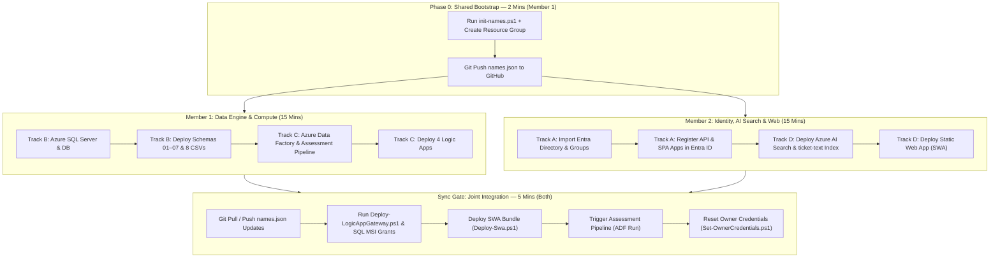

# Role Patrol (Team 20) — 2-Member Rapid Deployment Plan

> **Objective:** Deliver the complete, production-grade `T20_Role_Patrol` environment in **15–20 minutes** on a blank-slate Azure lab subscription using two parallel team members.  
> **Repository:** `https://github.com/arvindsathish/team-20`  
> **Working Directory:** `C:\Users\arvin\OneDrive\Documents\MyProjects\Hackathon_2026\t020_36de74`

---

## 1. Master Parallel Architecture & Work Division



---

## 2. High-Level Summary by Member

| Phase | Member 1 (Data Engine & Compute) | Member 2 (Identity, Search & Web) |
|---|---|---|
| **Phase 0 (2 min)** | Run `init-names.ps1`, create Azure Resource Group, push `names.json` to GitHub. | Clone repo, wait for Member 1's `names.json`, run `git pull`. |
| **Parallel Work (15 min)** | **Track B:** Deploy Azure SQL Server & DB, run schema scripts `01`–`07`, import 8 CSVs.<br>**Track C:** Provision ADF & pipeline, deploy 4 Logic Apps. | **Track A:** Run `Import-DirectoryFromDataset.ps1`, register API & SPA apps in Entra ID.<br>**Track D:** Deploy Azure AI Search & push 600 tickets, create Static Web App, set redirect URIs. |
| **Sync Gate (5 min)** | Pull `names.json`, run `Deploy-LogicAppGateway.ps1`, trigger ADF pipeline run. | Push updated `names.json` (with SWA URL & Client IDs), deploy `web/dist` with `Deploy-Swa.ps1`, run `Set-OwnerCredentials.ps1`. |

---

## 3. Member 1 Playbook: Data Engine & Compute

### Step 1.0: Shared Bootstrap (Run First)
```powershell
# 1. Initialize unique resource suffix and names registry
powershell.exe -NoProfile -ExecutionPolicy Bypass -File .\init-names.ps1
# Mental model: Generates unique 6-character resource suffix and populates local names.json configuration registry.

# 2. Create the unified project resource group
$names = Get-Content .\names.json | ConvertFrom-Json
az group create --name $names.ResourceGroup --location $names.Location
# Mental model: Provisions root Azure resource container isolating all project assets without resource reuse.

# 3. Share names.json with Member 2 via Git
git add names.json
git commit -m "chore: initialize shared names.json"
git push origin main
# Mental model: Publishes shared resource names registry to GitHub for team member synchronization.
```
> **Notify Member 2:** Tell Member 2 to run `git pull origin main` and start their tasks immediately.

---

### Step 1.1: Deploy Azure SQL Server & Database (Track B)
```powershell
$names = Get-Content .\names.json | ConvertFrom-Json

# 1. Deploy Azure SQL Server with Entra Admin
$adminUpn = (az account show --query user.name -o tsv)
$adminObjectId = (az ad user show --id $adminUpn --query id -o tsv 2>$null)
if (-not $adminObjectId) { $adminObjectId = (az ad signed-in-user show --query id -o tsv) }

az sql server create `
    --resource-group $names.ResourceGroup `
    --name $names.SqlServer `
    --location $names.Location `
    --enable-ad-only-auth `
    --external-admin-principal-type "User" `
    --external-admin-name $adminUpn `
    --external-admin-sid $adminObjectId
# Mental model: Provisions Azure SQL logical server enforcing Microsoft Entra-only authentication.

# 2. Configure Firewall Rules (Laptop Admin & Internal Azure Services)
$myIp = (Invoke-RestMethod -Uri "https://api.ipify.org")
az sql server firewall-rule create `
    --resource-group $names.ResourceGroup `
    --server $names.SqlServer `
    --name "LaptopAdminRule" `
    --start-ip-address $myIp `
    --end-ip-address $myIp
# Mental model: Authorizes client machine IP to connect to Azure SQL for schema deployments.

az sql server firewall-rule create `
    --resource-group $names.ResourceGroup `
    --server $names.SqlServer `
    --name "AzureInternalRule" `
    --start-ip-address "0.0.0.0" `
    --end-ip-address "0.0.0.0"
# Mental model: Authorizes Logic Apps, Azure AI Search, and ADF Managed Identities to access SQL.

# 3. Deploy Serverless Gen5 Database (Auto-pause 240 mins keeps it warm for demo)
az sql db create `
    --resource-group $names.ResourceGroup `
    --server $names.SqlServer `
    --name $names.Database `
    --edition "GeneralPurpose" `
    --compute-model "Serverless" `
    --family "Gen5" `
    --capacity 2 `
    --min-capacity 0.5 `
    --auto-pause-delay 240
# Mental model: Creates Serverless SQL database with 4-hour auto-pause delay preventing cold-start presentation latency.
```

---

### Step 1.2: Deploy SQL Schemas & Ingest 8 CSV Datasets
```powershell
# 1. Deploy relational schemas 01 through 07
$sqlFiles = @(
    ".\sql\01_schema.sql",
    ".\sql\02_engine.sql",
    ".\sql\03_operations.sql",
    ".\sql\04_status.sql",
    ".\sql\05_ticket_search.sql",
    ".\sql\06_permissions.sql",
    ".\sql\07_portal_api.sql"
)
foreach ($f in $sqlFiles) {
    powershell.exe -NoProfile -ExecutionPolicy Bypass -File .\scripts\Invoke-Team20Sql.ps1 -SqlFile $f
}
# Mental model: Deploys staging tables, deterministic assessment engine, casework ledger, and portal procedures.

# 2. Ingest 8 CSV datasets directly into Azure SQL
powershell.exe -NoProfile -ExecutionPolicy Bypass -File .\scripts\Import-HackathonDatasets.ps1 `
    -SqlServer $names.SqlServer `
    -Database $names.Database `
    -DatasetDir ".\datasets"
# Mental model: Populates SQL tables with 500 employees, 75 roles, 250 entitlements, 175 movers, and 600 tickets.
```

---

### Step 1.3: Deploy Azure Data Factory & Logic Apps (Track C)
```powershell
# 1. Create Azure Data Factory
az datafactory create `
    --resource-group $names.ResourceGroup `
    --name $names.Factory `
    --location $names.Location
# Mental model: Provisions Data Factory service orchestrator with system-assigned managed identity.

# 2. Deploy assessment pipeline
$pipelineJson = Get-Content .\templates\adf-assessment-pipeline.json -Raw
az datafactory pipeline create `
    --resource-group $names.ResourceGroup `
    --factory-name $names.Factory `
    --pipeline-name "RolePatrolAssessment" `
    --pipeline "$pipelineJson"
# Mental model: Deploys assessment pipeline scheduled to process tickets and historical mover friction.

# 3. Deploy the 4 Logic Apps (API A, API B, Collector, Shell)
powershell.exe -NoProfile -ExecutionPolicy Bypass -File .\scripts\Deploy-LogicApps.ps1
# Mental model: Provisions 4 consumption workflows with system-assigned identities for identity synchronization and API gateways.
```
> **Checkpoint:** Member 1 waits for Member 2 at the **Sync Gate**.

---

## 4. Member 2 Playbook: Identity, AI Search & Web

### Step 2.0: Sync Shared Configuration
```powershell
# Pull shared names.json created by Member 1
git pull origin main
$names = Get-Content .\names.json | ConvertFrom-Json
```

---

### Step 2.1: Import Entra Directory & App Registrations (Track A)
```powershell
# 1. Provision 30 demo employees and 16 entitlement security groups in Entra ID
powershell.exe -NoProfile -ExecutionPolicy Bypass -File .\scripts\Import-DirectoryFromDataset.ps1 `
    -DatasetPath ".\datasets\EMPLOYEE_IDENTITY.csv" `
    -GroupDatasetPath ".\datasets\ENTITLEMENT_CATALOG.csv" `
    -DomainName ((az rest --method GET --uri "https://graph.microsoft.com/v1.0/domains" --query "value[?isDefault].id" -o tsv))
# Mental model: Creates Entra ID user accounts and security groups matching the dataset ground truth.

# 2. Register API App Registration & expose RolePatrol.Access scope
$apiApp = az ad app create `
    --display-name $names.ApiAppName `
    --sign-in-audience "AzureADMyOrg" | ConvertFrom-Json

$apiAppId = $apiApp.appId
$names | Add-Member -NotePropertyName ApiClientId -NotePropertyValue $apiAppId -Force

az ad app update --id $apiAppId --identifier-uris "api://$apiAppId"
# Mental model: Registers backend API OAuth resource server and configures enterprise identifier URI.

# 3. Register SPA Browser Client Application
$spaApp = az ad app create `
    --display-name $names.SpaAppName `
    --sign-in-audience "AzureADMyOrg" | ConvertFrom-Json

$spaAppId = $spaApp.appId
$names | Add-Member -NotePropertyName SpaClientId -NotePropertyValue $spaAppId -Force
# Mental model: Registers client browser Single Page App registration for MSAL authentication.
```

---

### Step 2.2: Deploy Azure AI Search & Enriched Ticket Index (Track D)
```powershell
# 1. Provision Search Service (Basic SKU prevents free-tier quotas and supports semantic reranker)
az search service create `
    --name $names.SearchService `
    --resource-group $names.ResourceGroup `
    --sku "basic" `
    --location $names.Location
# Mental model: Deploys search service instance configured for lexical indexing, vector queries, and semantic reranking.

# 2. Run automated search deployment script (Index definition & Direct Semantically Enriched CSV Ingestion)
powershell.exe -NoProfile -ExecutionPolicy Bypass -File .\search\Deploy-Search.ps1 -NamesFile "..\names.json"
# Mental model: Creates ticket-text index and pushes 600 enriched access request tickets with business metadata.
```
> [!NOTE]
> `Deploy-Search.ps1` pushes enriched CSV data directly into Azure AI Search in under 60 seconds without needing to wait for SQL indexers!

---

### Step 2.3: Deploy Azure Static Web App & Set Redirect URIs
```powershell
# 1. Create Static Web App resource
az staticwebapp create `
    --name $names.StaticWeb `
    --resource-group $names.ResourceGroup `
    --location $names.Location `
    --sku "Free"
# Mental model: Creates globally distributed Static Web App hosting Role Patrol client dashboard and MSAL bridge.

$hostName = (az staticwebapp show -n $names.StaticWeb -g $names.ResourceGroup --query defaultHostname -o tsv)
$SWA_URL = "https://$hostName"
$names | Add-Member -NotePropertyName SwaUrl -NotePropertyValue $SWA_URL -Force

# 2. Save updated names.json locally
[IO.File]::WriteAllText((Resolve-Path ".\names.json").Path, ($names | ConvertTo-Json -Depth 5), [Text.UTF8Encoding]::new($false))

# 3. Register MSAL Redirect URIs in Entra ID
$redirectUri = "$SWA_URL/bridge.html"
$spaAppObjId = (az ad app show --id $names.SpaClientId --query id -o tsv)
$tmpSpa = [IO.Path]::GetTempFileName()
@{ spa = @{ redirectUris = @($redirectUri, "$SWA_URL/") } } | ConvertTo-Json -Compress | Out-File $tmpSpa -Encoding utf8
az rest --method PATCH --uri "https://graph.microsoft.com/v1.0/applications/$spaAppObjId" --headers "Content-Type=application/json" --body "@$tmpSpa"
Remove-Item $tmpSpa -ErrorAction SilentlyContinue
# Mental model: Authorizes Static Web App domain to receive Entra ID OAuth tokens via MSAL browser redirects.

# 4. Push updated names.json to GitHub for Member 1
git add names.json
git commit -m "chore: register SWA URL and Entra app IDs"
git push origin main
# Mental model: Shares SWA endpoint and client IDs with team repository for gateway configuration.
```

---

## 5. Sync Gate: Joint Integration (Both Members)

Once both tracks finish, complete the final handoff:

```powershell
# ─────────────────────────────────────────────────────────────────────────────
# MEMBER 1 (Or Whoever has Azure SQL connectivity):
# ─────────────────────────────────────────────────────────────────────────────
# 1. Pull the updated client IDs and SwaUrl from Member 2
git pull origin main
$names = Get-Content .\names.json | ConvertFrom-Json

# 2. Configure Logic App Gateways, SQL MSI Users, and Search Reader RBAC
powershell.exe -NoProfile -ExecutionPolicy Bypass -File .\scripts\Deploy-LogicAppGateway.ps1
# Mental model: Binds Managed Identities to SQL procedures, secures Logic App gateways, and outputs web config.

# 3. Trigger the Data Factory Assessment Pipeline Run
az datafactory pipeline create-run `
    --resource-group $names.ResourceGroup `
    --factory-name $names.Factory `
    --pipeline-name "RolePatrolAssessment"
# Mental model: Triggers ADF execution to calculate historical friction metrics across all 75 roles.
```

```powershell
# ─────────────────────────────────────────────────────────────────────────────
# MEMBER 2:
# ─────────────────────────────────────────────────────────────────────────────
# 1. Deploy pre-compiled web bundle to Azure Static Web Apps (Zero-NPM deployment!)
powershell.exe -NoProfile -ExecutionPolicy Bypass -File .\scripts\Deploy-Swa.ps1
# Mental model: Publishes production UI bundle with embedded catalog and theme tokens to global CDN.

# 2. Reset Role Owner demo passwords
powershell.exe -NoProfile -ExecutionPolicy Bypass -File .\scripts\Set-OwnerCredentials.ps1
# Mental model: Generates fresh credentials for Doreni and Alira for live role certification sign-in.
```

---

## 6. Verification & Presentation Readiness

Within 20 minutes, open your live portal at `$names.SwaUrl`:
1. **Simple View Dashboard:** Verify 75 roles listed with priority ranking, clean **`IMPACT`** column, and zero clutter.
2. **Deterministic Evidence Drawer:** Click **Inspect** on `BR0008` (Credit Review Specialist US) and verify all **5 Grounded Pillars of Proof** with generous vertical spacing.
3. **Multi-Insight Role Differentiator:** Click **⚖️ Role Differentiator** and toggle between:
   - `🔑 Entitlements`
   - `👥 AD Security Groups`
   - `💻 Application Access`
4. **ServiceNow Remediation:** Click **`+ Req`** or **`⚡ Submit ServiceNow Request →`** to showcase automated catalog item generation.
5. **AI Semantic Search:** Query natural language access defects (e.g. `unable to export financial ledger`).
